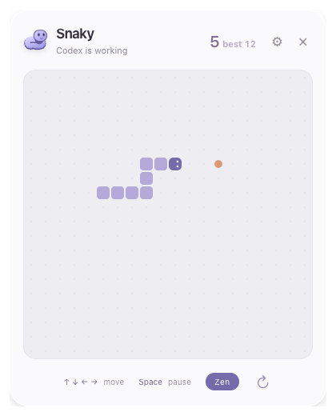

<p align="center">
  
</p>

<h1 align="center">Snaky</h1>

<p align="center">
  A small Snake companion for macOS while Codex or Claude Code works.
</p>

<p align="center">
  
</p>

- **Open / tuck away:** Press **⌥ ⇧ S** (`Option + Shift + S`) or click the corner snake while your agent works; **Esc** tucks it back.
- **Move:** **↑ ↓ ← →** or **WASD** (physical keys, works on any keyboard layout).
- **Pause / restart:** **Space** pauses or resumes; **R** restarts.
- **Zen mode:** Toggle **Zen** in the footer to wrap walls, trim your tail on self-bites instead of ending the game, and track your longest tail (`best`).
- **Auto-hide:** Steps aside automatically when the agent finishes, is interrupted, or needs your input.

## Install

Requires macOS, Node.js, and Rust (`cargo`).

```sh
npm install
npm run tauri build
rm -rf /Applications/Snaky.app
cp -R src-tauri/target/release/bundle/macos/Snaky.app /Applications/
/Applications/Snaky.app/Contents/MacOS/agent-snake --install-integrations
```

- Or open `/Applications/Snaky.app` → **⚙** → **Connect / repair** (**Disconnect** removes Snaky's hooks from `~/.codex/hooks.json` and `~/.claude/settings.json`).
- After updating, restart any running background process (`pkill -x agent-snake`) and active Codex / Claude Code sessions.

## Develop

```sh
npm run tauri dev
```

Run checks with:

```sh
npm test
npm run build
cargo test --manifest-path src-tauri/Cargo.toml
```
